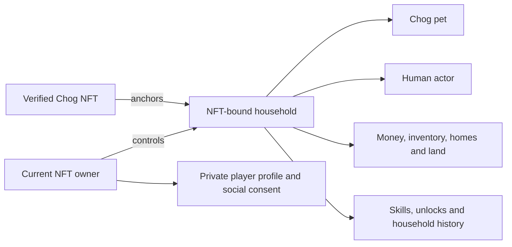
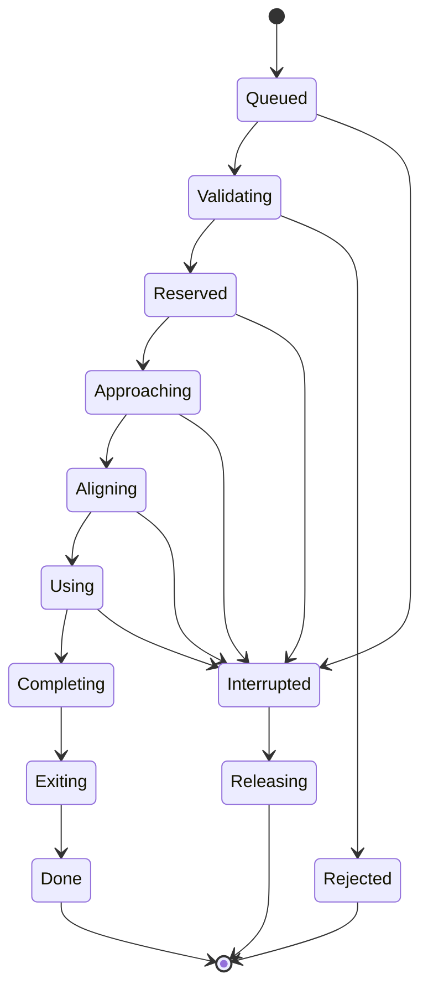
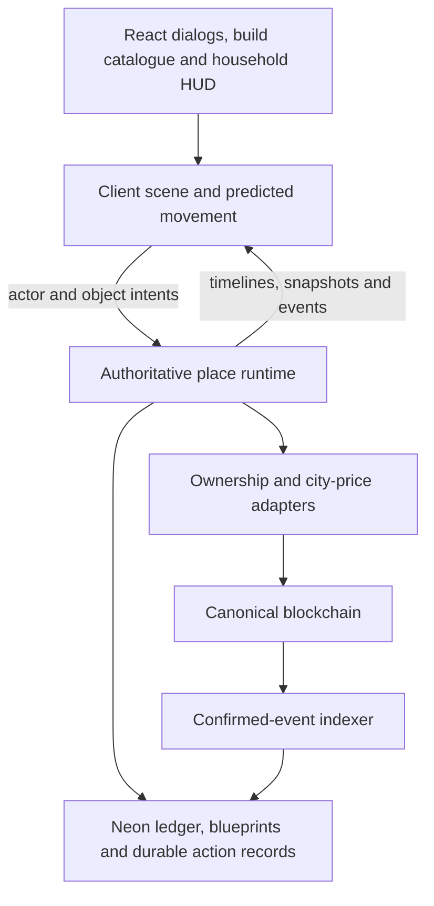

# Chain World: households, Chog pets and a playable living world

Proposed architecture and gameplay plan, 23 October 2026. Reviewed against local commit `635a02fc1d1c896e9532f490efcef467b21f4dc0`. The existing checkout was used directly. This document proposes the next implementation; it does not describe features as shipped.

The player controls a human who lives with their Chog pet. The Chog NFT determines the household's identity, initial circumstances, visual heritage and economic account. A satisfying session should involve making decisions in a home or city: cooking, furnishing a room, walking the pet, meeting someone, visiting a venue or taking a trip. The world should remain useful when no other player is online.

The supplied bedroom image establishes an anime-inspired illustration style: clean outlines, cel shading, soft colors, clear silhouettes and readable everyday objects. It does not prescribe a bedroom layout, house design, furniture arrangement or camera angle.

## 1. What the existing code actually provides

The current NFT/source infrastructure and persistence are useful foundations. The world simulation needs a larger change than adding more buttons.

| Area | Evidence in this checkout | Required change |
| --- | --- | --- |
| Player and Chog | [GameState](../src/game/types.ts), [trait mapper](../src/game/traitMapper.ts) and [room renderer](../src/world/RoomScene.ts) describe/render one Chog actor. [Profile](../src/game/residentProfile.ts) changes gender text. | Separate the human, pet and household. Signup chooses the human's sex/body presentation; NFT traits seed their appearance. |
| Indoor objects | [Navigation](../src/world/navigation.ts) defines a fixed 7×7 room and four hardcoded furniture positions. | Persist object instances and derive navigation from the actual floor plan and furniture. |
| Interaction authority | `RoomScene` owns indoor routes and a temporary three-action queue. `startAction` in the [reducer](../src/game/gameEngine.ts) and [command parser](../server/commands.ts) takes an action kind without an object ID. | Validate actor position, target, access, reservations, resources and action stages on the authority. A browser request must not bypass walking or furniture ownership. |
| Housing | The [HUD](../src/components/GameHUD.tsx) offers a palette, visitor toggle and numerical upgrade. `RoomScene` always loads the same room and four furniture assets. | Real rooms, walls, doors, windows, furniture inventories, building and placement tools. A sparse start must actually look and play sparsely. |
| Five cities | [Neighborhood definitions](../src/game/neighborhood.ts) and [StreetScene](../src/world/StreetScene.ts) reuse one 36×39 street grid and four service types. Names and tints change. | Different district topologies, enterable venues, park activities, schedules, residents and local production loops. |
| Travel | `travel` immediately changes `currentZone` and places the actor at a station coordinate. A Travel button can be used without reaching a station. | A persistent itinerary with departure, boarding, arrival and a return route. |
| Visits | The server checks an open home and doorway proximity. The HUD substitutes the host's style and housing tier into the same room. | Load the host's actual blueprint and objects into a shared interior; enforce room/object permissions and occupancy. |
| Social life | [World SQL](../server/world-schema.ts) supports wave/chat/high-five and a cooldown. [Neighborhood API](../server/neighborhood.ts) returns recent gestures. | Persistent relationships, conversations, invitations, memories and joint activities. |
| World location | Neighborhood queries use `home.district`, even when the actor is visiting another city. | Store current city, district, place and room separately from home ownership. |
| Synchronization | [Controller](../src/hooks/useGameController.ts) polls game state every five seconds; [neighborhood hook](../src/hooks/useNeighborhood.ts) polls every ten seconds. | Responsive movement and shared interactions need a room authority and event stream. Economic persistence can remain transactional. |
| Economy | NFT-keyed Neon state and escrow already exist. [Land contract](../contracts/ChainWorldLand.sol) is separate and undeployed; its currency transfers currently use wallet ERC20 balances. | All economic accounts, inventories, settlements and obligations must identify the Chog household. Complete onchain settlement separately from the simulation. |

Preserve the verified collection/source mapping, faucet, registry, wallet authentication, idempotent command receipts, escrow principles and pure simulation code. Replace the fixed-room/fixed-service assumptions. Existing tests establish the old behavior; they do not establish that the proposed Sims-like experience exists.

## 2. The household is the unit of ownership

Use the active NFT identity `(chainId, collection, tokenId)` as the household key. Keep its verified original collection/token mapping alongside it. On the current testnet, copy token `0` maps to original token `1`, whose metadata name is `CHOG #1462`; these are three different identifiers.

The wallet authorizes control. The household owns the game assets. Changing wallets, names, sex, clothes or cities never creates another starting grant. A player with several Chogs has several distinguishable households and selects one active household; they cannot spend one household's funds from another without an explicit transfer.

Recognized collections and environments are server-configured. A browser cannot nominate another contract or supply a favorable rarity. New economic grants require verified ownership and the approved metadata policy; missing/unverified source data defers household creation or permits a separate local preview rather than issuing a speculative starting package.

The pet remains present in normal play: following, resting, exploring, asking for attention, using its bowl and toys, reacting to people and taking part in activities. Its NFT portrait and original traits remain visible. It is not reduced to an account badge after adding the human.

Public household progress and private player identity have different transfer rules. A new NFT owner receives its pet, money, inventory, land, buildings, skills and economic obligations. Their own signup choices determine their human presentation. Private messages, block lists and human social consent do not become the buyer's property. Public household memories can remain as history; invitations and romantic commitments require renewed consent after a controller change.

## 3. Signup and human generation

The signup flow should be:

1. Connect, select/claim a Chog and verify current ownership and its source metadata.
2. Choose a human name and sex/body presentation. Support male, female and a custom/androgynous presentation; allow a separate gender label and pronouns. These choices do not change economic privileges.
3. Preview the generated human next to the authentic Chog. Explain the few visible trait connections.
4. Create the household once, allocate its home and show a short arrival sequence.

Use a versioned, server-reproducible seed derived from NFT identity, source token ID, metadata fingerprint and generation rules. Derive separate named random streams for the human, home, furniture and pet preferences. Never use `Math.random()` at render time or include the wallet address in an economic seed. Store the generated result as well as the rules version.

| Verified Chog metadata | Human interpretation | Pet/home interpretation |
| --- | --- | --- |
| Skin / Background / Aura | Hair accents, clothing colors and accessory palette, selected from compatible sets | Pet coloring/effects and preferred interior palette |
| Eyes | Eyewear family or eye styling; choose a compatible frame deterministically | Preserve the pet's actual eyes/eyewear |
| Head | Hat/headwear family or a hairstyle/accessory combination | Preserve actual pet head traits |
| Body | Starting clothing family and colors | Preserve the NFT's pet outfit |
| Accessory | A coordinated cosmetic accessory or motif | Pet accessory and furnishing preferences |
| Base / Form | Distinct visual motif in the human's outfit | Actual special pet anatomy; special forms need authored assets |
| Tier | No effect on human sex, attractiveness or skin tone | Determines the starter entitlement described below |

Traits constrain a pool; the seed chooses features within it. Thus humans associated with similarly dressed Chogs share a recognizable visual family without becoming copies. A pink Chog need not produce literal pink human skin: pink hair accents/clothing can carry the trait while human skin tones come from a broad curated set. The source `Naked` trait describes the pet and must not force an undressed human.

Changing body presentation should fit the same generated features to the selected rig. It must not reroll the home, money or inventory. Earned wardrobes, hairstyles and accessories provide later customization while keeping the Chog-derived starting identity visible.

Human needs: hunger, energy, hygiene, fun, comfort and social connection. Pet needs: hunger, rest, stimulation and affection. Show one selected actor's detailed needs at a time and a small status indicator for the other. Pet temperament changes preferences and behavior, with a versioned mapping explicitly described as game adaptation of metadata. Skills grow through play rather than assigning intelligence or economic ability from the player's sex.

## 4. Fix rarity before generating houses

The source [trait catalogue](../data/chog/trait-catalogue.json) contains five `Tier` values: Common **1,279**, Uncommon **590**, Rare **60**, Epic **30**, Legendary **10**. The current [rank bands](../src/game/traitMapper.ts) instead use six computed-frequency categories, including Floor and Genesis.

This is a real discrepancy: original token `1` has source `Tier: Uncommon`, but the current game calls its computed rank `169` Legendary. The proposed economic policy is:

- **Source Tier determines the starter house class and entitlement budget.** This is the NFT rarity present in the verified testnet metadata.
- Computed trait-frequency rank remains a separate statistic and may influence a small, bounded variation within that tier. It cannot silently promote an Uncommon NFT into the Legendary housing class.
- Other metadata influences architecture, palette, furniture themes and pet preferences. It does not bypass the tier's total allocation limits.
- Freeze the metadata fingerprint and economic rules used for the initial grant. A later catalogue/ranking change must not reissue wealth.

Prototype starting packages below are balancing proposals in internal gCHOG, not token market prices. The move-in budget is **cash plus the reference value of movable furniture**; it is not an additional full cash grant on top of the chosen furniture. Land and shell entitlements are separately capped by the same tier configuration.

| Source Tier | Initial plots | Home family and enclosed floor area | Movable furniture | Move-in budget |
| --- | --- | --- | --- | ---: |
| Common | 1 | Tiny shell/studio, 16–24 build cells | 0–3 inexpensive or worn pieces; an empty shell is a legitimate outcome | 200 |
| Uncommon | 1 | Small cottage/flat, 24–36 cells | 2–6 functional pieces; important gaps remain | 500 |
| Rare | 2 | Comfortable house, 36–52 cells | 5–9 coordinated basics and one hobby/pet item | 1,200 |
| Epic | 2 | Larger garden house, 52–72 cells | 8–13 pieces, better comfort and a themed feature | 2,500 |
| Legendary | 3 | Distinctive villa, 72–96 cells | 12–18 quality pieces, a signature room and substantial pet space | 5,000 |

Furniture counts include small objects. The generator must also pass footprint, circulation and room-capacity checks; it may use fewer objects rather than crowd a small room. House shapes and contents vary within a tier. Every tier can ultimately build the same functional home features through play; rarity changes the start, not permission to participate in city life.

Reserve a useful amount of the move-in budget as cash. For an empty Common house, a larger proportion remains cash; this is not both an empty room and a zero-resource punishment. Public bathrooms, inexpensive cafés, a free rest shelter, communal pet care and starter errands must make that start playable. Empty-house players do not receive an invisible kitchen or workstation through an action bar.

The current published land-rarity proof root encodes computed ranks and the undeployed land implementation interprets those six bands. New source-tier starter entitlements therefore need a separately versioned proof/configuration and matching contract logic before activation. Keep the deployed faucet's original-source root unchanged; housing policy is a separate commitment.

### Generation sequence

Verify source → choose the tier envelope → select a city-compatible floor-plan grammar → choose architectural/palette motifs from traits → allocate an available legal lot → generate connected rooms/doors → populate furniture sockets within the value budget → validate both human and pet routes → persist the result and the single starter-grant receipt atomically.

Use authored room modules and constrained variation for the first release: mirrored layouts, room arrangements, doorway choices, palettes and compatible furniture sets. Fully unconstrained procedural walls are a later option. If a generation attempt fails, advance a stored deterministic attempt counter and use a validated fallback of the same entitlement class. Never grant an extra package on retry.

Lot selection must account for occupancy. The seed gives a candidate order, while one allocation transaction records the actual available parcel. Reconnecting cannot repeatedly search for a better layout or duplicate furniture. Version the source manifest, entitlement policy, house grammar and object catalogue independently.

## 5. An interaction is a physical sequence

Create one interaction system for household objects, pets, NPCs, other humans and venue objects. Each placed object has an instance ID; a bed is not the global action category `rest`.

An object definition needs: supported rotations, solid footprint, approach tiles, use slots, actor pose anchors, animation/prop markers, required utilities, allowed users, capacity and affordances. Instances add their transform, owner household, place, condition, cleanliness, stored contents and state. A sofa can have two seats; a stove can be occupied; a bowl can actually contain food.

Clicking an object highlights it and opens a contextual action dialog. Show the actor who would perform each action, duration, resource use, expected benefits and a concrete unavailable reason. Selecting a sofa should offer sit, nap, read, chat with a nearby person and invite someone to sit; the available choices depend on context. A pet interaction should offer call over, pet, brush, feed, play and train according to pet state and available objects.

The server validates and owns the action state. The browser predicts movement and renders the approved timeline. A queued request references actor, target object, interaction definition, place/navigation revision and an idempotency key. The authority selects a reachable free slot and reserves it with an expiring lease. It revalidates at the start of use. A target moved, sold, broken or made private while the actor approaches must trigger a visible replan or interruption.

Version the command protocol and retire the public `startAction(kind)` path for the shared v3 world. Every equivalent shared request must identify a valid actor and target instance. Old commands can remain in the isolated local preview adapter, but must not bypass the new shared-world validator.

Reserve resources before walking; consume them at documented action markers. Unused holds are released on failure. Consumed ingredients are not magically refunded; a partially cooked meal remains a world object that can be finished or discarded. Completion rewards and inventory outputs are recorded once per action instance. Reconnecting resumes the same timeline rather than issuing another reward.

### Concrete interactions to implement

| Object / place | Meaningful sequence | Persistent consequence |
| --- | --- | --- |
| Fridge + counter + stove + table | Pick recipe → gather ingredients → prepare → cook → carry plate → reserve seat → eat → clear dish | Ingredients, meal quality, leftovers, dishes, hunger, cooking skill |
| Bed | Approach the accessible side → turn → get in → sleep → get out through a valid exit | Energy/comfort; optional assigned side; pet may use its own bed |
| Sink / shower / toilet | Walk to fixture → privacy check → use animation → finish | Hygiene, utility demand and fixture cleanliness |
| Desk / laptop | Pull chair out → sit → choose a project → work → save → stand | Skill, project progress and a household income receipt |
| Sofa / bookshelf | Sit or choose a book → read, nap, watch, or invite someone to chat | Fun/comfort, reading progress, shared memory |
| Pet bowl | Owner fills bowl from inventory → pet approaches → eats | Actual food quantity, pet hunger and a dirty/empty bowl |
| Pet toy / training mat | Call pet → pet accepts or is distracted → play/train → put toy down | Bond, learned behavior, toy wear; no automatic currency for repeated clicks |
| Park bench / picnic table | Reach park → reserve seats → unpack food → invite companion | Shared meal, friendship memory, consumable use |
| Shop counter | Reach counter → browse stock → choose delivery/carry → confirm quote | NFT-bound purchase, stock change and delivered furniture/item |
| Doorbell / front door | Approach → ring/knock → host accepts or policy permits → enter | Visit session, access grant and household memory |

### Movement and autonomy

Compute routes from one shared map representation. Walls, door edges, terrain, furniture footprints, door swings and interaction clearance are authoritative. Human and pet have different footprints; a pet can use designated small gaps without granting the human the same route.

Navigation ends at an approach slot. An authored alignment animation then moves the actor into a chair/bed pose; collision is relaxed only for that reserved interaction slot and actor. It is not a global teleport or a path through the furniture. Exiting uses a still-valid exit tile. Sort draw depth from feet/contact points and explicit foreground layers.

Use occupancy/short reservations to prevent two people taking the same chair. Doorway conflicts should make actors wait, yield or reroute. Reserve multiple resources in a stable order with bounded leases so a joint meal cannot deadlock several tables. A no-route failure should identify the obstruction and release holds.

Give humans and pets independent queues, initially up to six commands per actor, with reorder/remove controls. Persist approved queues. NPC/pet autonomy scores needs, interests, relationships, distance, object availability and repetition. Explicit player orders win unless an urgent need or safety rule requires interruption. Ambient autonomy never spends large sums, sells furniture or accepts a trade.

## 6. Houses are editable spatial objects

Separate three concepts: **estate parcels**, **building geometry**, and **placed contents**. Buying a neighboring parcel must extend the legal buildable area; it must not only increase an estate counter.

Start with one building floor. Represent each parcel's buildable polygon, public right-of-way boundaries and a finer build grid. An initial tuning choice is eight build cells per parcel edge, with scale finalized against human/furniture dimensions. Walls lie on cell edges; doors/windows attach to walls. Room detection and navigation derive from geometry. Furniture is stored as independent instances on cells or supported surfaces.

The current street map puts public sidewalks between repeated building pads. Two entries next to each other in an 8×8 ownership array therefore do not automatically form a physically mergeable building site. The new parcel model must encode a shared private boundary and legal merge edge; public roads and sidewalks stay outside build permissions.

### Build mode

Enter Build/Buy from the house or estate. In a shared world, this pauses the editor's household autonomy and acquires a building-edit lease; it does not pause the city's clock or other players.

The first tools should support drawing/removing walls, dragging room rectangles, placing doors/windows, selecting wall/floor finishes, moving rooms where valid, and growing into purchased land. Show a ghost preview, dimensions, ownership boundaries, door clearances, blocked paths and an itemized cost. Include undo/redo for the uncommitted draft, cancel, and one explicit Apply changes transaction.

The authority validates the entire edit against the expected building version, ownership, funds, structural rules, object support and reachability. Invalid or stale edits debit nothing. Accepted edits increment the building/navigation versions and publish a new layout to occupants. Relocate actors only to documented safe standing tiles when an accepted edit would affect them; never erase an actor or trap one behind a newly built wall.

Maintain routes from the entrance to essential facilities and a safe exit. Prevent doors opening into solid furniture, objects placed outside owned ground, furniture on unsupported floors, windows on nonexistent walls, and deletion of a wall still supporting mounted objects. The UI should offer moving supported objects into inventory as part of the same draft.

### Buy mode

The catalogue should show category, footprint, compatible rotations, price, utility requirements, comfort/function and condition. Provide preview placement, rotate, recolor, store, sell and duplicate from available inventory. Buying a new object and placing it is one operation; moving an owned object is not another purchase.

Use inventory and ownership provenance for every furniture instance. Support worn secondhand items, repairs, cleaning, household-crafted objects and delivery. A lamp, plant, picture, rug, pet bed and bowl can make a tiny room feel personal before a player can afford structural expansion.

A furniture item must have art and use anchors for every advertised orientation. Mirroring an asymmetric stove is not automatically a correct new rotation. Limit unsupported rotations visibly until the corresponding art and interaction anchors exist.

### Land, expansion and housing progression

Offer an available adjacent parcel through the estate boundary or a city property office. For occupied land, create a named NFT-to-NFT offer with price, parcel preview, expiry and escrow. A seller can inspect the resulting lot boundaries. Protect the main entrance, required access and both estates' connectivity. Include placed structures and furniture in the sale preview; initially permit parcel sales only when the sold parcel is unbuilt and free of attached objects.

Upgrade through concrete projects: add a bathroom, extend a kitchen, build a pet garden, add a study, improve insulation or replace a bed. The numerical housing tier becomes a derived summary of actual space, amenities, condition and comfort. It no longer creates facilities by itself.

Room templates and a furnishing assistant can help players who do not want to build tile by tile. They still purchase/place real catalogue objects and use the same validation. Later expansions can add stairs/multiple floors, balconies, pools, large gardens, rental homes and player businesses. They depend on the basic spatial system rather than another isolated menu.

## 7. Five cities with different daily lives

Retain the five existing city identities. Give each its own topology, skyline, material palette, soundscape, public space, businesses, NPC routines, local products and reasons to return. Reuse interaction code and common furniture while authoring genuinely different arrangements and activities.

| City | Spatial/visual identity | Enterable destinations | Park and local loop |
| --- | --- | --- | --- |
| **Monhattan — Monad** | Compact violet-accented streets, trams, parallel pedestrian lanes and a busy central square | Parallel Perk café; Ten Thousand TPS Works, with desks, project terminals and a community workshop | Monad Meadow has pet agility, fetch areas, benches and a community noticeboard. Train a Chog, join a workshop, meet regulars. |
| **Gwei York — Ethereum** | Dense limestone townhouses, broad avenues, older civic buildings and crowded plazas | Expensive Espresso; Gaslight Gallery, with exhibitions, auctions and a restoration job area | Central Gwei Park offers picnics, chess, buskers and evening walks. Earn a gallery commission or attend an opening; public park access remains affordable. |
| **Basedford — Base** | Walkable blue waterfront, terraced cottages, boardwalks and maker courtyards | Based & Breakfast; Builder's Block Studio, with real crafting benches, displays and collection counters | Blue Sky Gardens connects community gardening and the promenade. Grow inputs, make furniture, deliver it or meet someone for breakfast. |
| **Arbiquerque — Arbitrum** | Terracotta courtyards, winding arcades, shaded passages and a night market | Arbi's Sandwich Counter; Optimistic Bazaar with repair, appraisal and used-furniture stalls | Seven Day Gardens supports group games, quiet seating and pet socialization. Repair used furniture, fulfill a market request and return for a scheduled event. |
| **Polygone-on-Sea — Polygon** | Colorful seaside streets, mosaics, beach paths and a ferry promenade | Many Sided Meals; Mosaic House, with art/craft stations and a local shop | Mosaic Shore Gardens offers beach walks, shell/art-material gathering, picnics and pet play. Make décor, furnish a home and join a seaside festival. |

Every city also needs a transit node, residential district, accessible rest/bathroom/pet-care services and a property/information point. Distinct character should come from layout and gameplay as much as colors. An “open” door must lead to an actual place; purely decorative façades should not advertise an enterable action.

### Places and interiors

Use a location hierarchy: world → city → district → place → room → navigation cell. A café is an instance with a door, opening schedule, host NPC, counter, stock, tables, seats, kitchen and customer behavior. A park is a navigable place with paths and activity objects, not one icon that raises social needs.

Give each hero landmark at least three activities, an NPC or player encounter, and a distinctive item/skill/event connection. Markets need finite stock and delivery; parks need usable benches, toys and picnic surfaces; galleries need inspectable displays and commissions. The same affordance system should operate in each.

NPCs should have a home/workplace, daily schedule, interests, relationships and small recurring concerns. A barista remembers the regular who helped repair a coffee machine; a gardener offers a cutting after repeated visits. Schedule changes should make a city feel alive without making services unavailable for most real-world play hours. Offer recurring sessions and asynchronous alternatives.

Make activities visible through environmental state: a workshop displays an unfinished commission, a café table keeps its dishes until cleared, a garden changes as plants grow and the home gains clutter through use. Add lighting, lamps and modest weather variations after those systems work. A crowded calendar of popups is less useful than a park whose objects, residents and ongoing activities can be seen and joined.

A shared public clock can drive lighting, opening windows and events. Retain the current time scale initially, then measure play pacing. Shared cities cannot be globally paused or fast-forwarded by one player. Sleeping resolves a bounded action; solo preview may expose time controls separately.

### Initial city content budget

For each of the five cities, target one residential block, one fully walkable park, two enterable staffed venues, one usable transit node, two service NPCs and four ambient NPCs. Of the venue activities, at least two per city should be distinctive rather than renamed copies. Common actions can be shared across cities.

This is a release content target, not content already present. Prove the systems in one complete Monhattan loop first, then require the same acceptance bar in all five. A city does not count as complete because its map marker and skyline exist.

## 8. Travel should be part of play

The world map should show cities, districts, landmarks, friends, transport connections, travel time and a quoted fare. Selecting a destination can queue the walk to the departure station. It must not directly overwrite the actor's city.

An itinerary is: **plan → approach departure → confirm/hold fare → board → transit → arrive → walk to destination**. Record a journey ID, origin/destination places, household, accompanying pet/accepted party, departure/arrival timestamps, quoted fare, quote expiry and cancellation rules.

Use walking within districts, tram/bus between districts and chain-themed train/ferry routes between cities. Transit can be a short illustrated carriage/deck scene, with a skip-animation control that preserves the actual arrival timestamp. Prototype intercity trips can take 10–30 seconds; tune for the browser session rather than realistic commuting duration.

Keep travel state independent of `home.city` and `home.district`. Visiting another district must actually load that district's households and landmarks. Reloading during transit reconstructs the same trip and debits the fare once. A failed destination load retries or resolves to an accessible arrival point with a defined refund; it cannot strand the NFT in an unrenderable state.

Public access to all five cities should eventually be open to every household. Remove blanket XP/rarity city locks as the primary exploration gate. Use money, scheduled transport, venue access and skills for specific opportunities. Retain free emergency travel home and free local recovery. City travel should not also mint another home or another starting budget.

The Chog can accompany the player, remain safely at home with supplies, or use earned care arrangements. Joint travel invites require acceptance and quote each household's obligations. Vacations, hotels and an earned second property are later additions; one NFT gets one starter estate, not five automatic estates.

**Blockchain boundary:** initially the five cities use their real chains' economic observations while household ownership/settlement remain on Monad Testnet. A virtual tram trip is not a cross-chain NFT bridge. For the eventual mainnet version, keep one canonical NFT/household authority and define any real multi-chain deployment through explicit messaging and escrow before claiming cross-chain assets. Never duplicate the pet or economic account across cities/chains.

## 9. Visiting homes and building relationships

### Home visits

Support public, friends-only, invitation-only and closed homes, plus per-room and per-object permissions. Let a player ring the doorbell, request a visit, invite a nearby resident, schedule a gathering or travel to an accepted invitation. A host can admit, deny or end a visit.

Guests enter the host's exact building version, furniture layout and current object states. They can sit on the host's actual sofa and share its available seats. They cannot see private storage, redecorate, sell items, spend the host's funds or consume stocked food without permission. Households can contribute food or a gift explicitly. Guests keep their own needs, money, inventories and pets.

An offline home may open for a read-only tour under a stored policy. It must not impersonate an offline human, manufacture their social consent or expose private rooms. Closing a home or changing ownership invalidates old invitations; existing guests leave through a safe exit or are returned to the public entrance.

### Persistent relationships

Store directional friendship, trust, familiarity, optional romance and shared memories. Friendship alone is insufficient: a dependable neighbor and a fun casual acquaintance should offer different interaction choices. Keep a lightweight contact/history panel with last meeting, interests learned, pending invitations and recent shared moments.

Conversations should have authored topics and contextual outcomes: introduce self, discuss Chogs, ask about a hobby, tell a joke, compliment a home, offer help, apologize or plan an outing. Compatibility, current mood, remembered behavior and repetition affect the response. A repeated “chat” click should not farm unlimited relationship points or currency.

Unlock shared activities organically: sit together, cook dinner, picnic, play chess, visit a gallery, walk pets, attend a workshop or help furnish a room. Store a memory with participants, place and activity, such as “shared a first picnic in Monad Meadow.” NPCs provide these loops even in quiet multiplayer periods.

For player-to-player interactions, distinguish passive acknowledgment from joint actions. A wave can be received without taking control. A hug, date, trade, home invitation or trip requires the recipient's acceptance, availability and current access rights. Include decline, block and visitor removal in the same interaction model. NPC romance and mutually opted-in adult player romance can follow friendship after the shared-activity system works; they are not needed to prove the initial housing slice.

Relationships do not merge NFT ownership or automatically create a joint bank account. Co-residence is a revocable permission to use another household's space. Contributions, loans, gifts and shared meals identify the paying household and transfer the actual resource once. A gift cannot be sold to a vendor repeatedly for more than its household purchase cost.

### Human–Chog and Chog–Chog bonds

Pet care should create daily life: the Chog follows a trusted human, chooses a favorite resting place, reacts to unfamiliar guests, seeks a toy and learns simple commands. Pet friendship can make meeting another owner easier. A pet can prefer quiet or busy places and respond to furnishings from its trait family.

Keep training benefits bounded and activity-based. The Chog should remain safe during absence; use capped offline need changes and care recovery rather than permanent pet loss. Additional pets or breeding must not create new NFT economic identities or repeat starter grants. Additional economic Chogs require actual recognized NFTs.

## 10. The entire game economy belongs to Chog households

“NFT-centered” must be an ownership and accounting rule, not just an entry gate. Every economic command specifies a source and/or destination household key: work income, crafting inputs, meals, furniture, construction, land, transport, gifts, escrow and eventual real-token settlement.

### Asset and transfer rules

| Resource / record | Owner or authority | Behavior on NFT transfer |
| --- | --- | --- |
| Household gCHOG account, inventory, homes, furniture, land | Chog household | Remains attached to the same NFT |
| Pet identity, learned behaviors, household skills and unlocked recipes | Chog household | Persists; starting metadata does not reroll |
| Held trade funds, pending offers, deliveries and construction | Recorded household obligations | Persist or resolve under explicit rules; cannot be abandoned by switching wallets |
| Current human control lease and pending unsigned actions | Current verified owner/session | Old control revoked; uncommitted owner-specific intents invalidated |
| Human name/presentation and private player records | Player profile | New owner selects their own presentation; private records are not sold |
| NPC familiarity/public household history | Household/world | Can persist as reputation/history, with bounded economic influence |
| Player-to-player relationship consent and private messages | Players | Require new-controller consent; never inherit private conversations |

Represent currency movements with balanced ledger entries and a unique operation ID. An internal currency issuance is a recorded grant/reward from a defined system account. A furniture purchase moves household credits to a shop/system account and creates one item. A player trade moves an existing item and credits between two NFT households. The ledger, assets and idempotency receipt commit atomically.

### Income, spending and progression

Earn through venue-based work, commissions, deliveries, gardening, crafting, repairs, tutoring and pet activities with a defined prize budget. Work requires time, skills, resources or a completed task; a generic home button should not generate unlimited money without an actual desk/job. Rarity provides starting capital and distinctive opportunities; progress must still depend on play.

Spend on food, ingredients, utilities, repairs, travel, furniture, construction, crafting tools/materials, venue services, pet supplies and land. Long-term aspirations should be concrete: a furnished kitchen, a larger pet garden, a workshop, a hosted dinner or a second-city vacation. Optional décor provides sinks without turning basic survival into a daily tax trap.

Limit guaranteed payouts with household-specific cooldowns, work budgets and diminishing returns for repeated trivial tasks. Calculate the total possible starter allocation across the fixed NFT corpus before activating a rules version. Moving an NFT between wallets cannot reset grants, rewards, jobs or cooldowns. Publicly predictable spawn variation is acceptable; do not describe deterministic assignment as secure randomness. Rare randomized prizes would need a separate committed/verifiable entropy mechanism.

Track issued credits, NPC/vendor sinks, player-to-player volume, money distribution by source tier, and time to reach core housing milestones. Prototype targets: every empty-house start can acquire a basic rest/food solution in its first session; ordinary play can fund a visible furniture improvement in roughly 10–20 active minutes. These are tuning targets to validate, not existing measurements. Do not give the large starting tier a permanent uncapped income multiplier.

### Gas-sensitive city costs

Retain gas-driven city identity, but separate the displayed gas observation, the game price index and an actual token exchange rate. Raw gwei from different native currencies is not directly comparable. The current [gas baselines](../src/game/zones.ts) create a nominal bounded game index; they are not a gCHOG market quote.

For the testnet prototype, quote:

`price = round(base object/service price × city cost factor × bounded smoothed gas pressure)`

Use a rolling observation window, bounded change, quote timestamp and a short validity period. Show the final price and change before purchase. Do not reprice a committed build draft, accepted fare or escrowed offer mid-operation. Stale data can sustain cheap essential care at a clearly marked nominal price; pause speculative/high-value system sales until a current quote exists.

For literal native-token-to-CHOG mainnet pricing, add a separately validated conversion adapter for gas units, native-token value, CHOG value, decimals and chain-specific fee components. Base/Arbitrum fee modeling must include applicable data fees rather than treating execution gwei as the entire cost. An internal test credit with no external price cannot supply a real exchange rate. Economic units and missing-feed behavior must be explicit before any real-token settlement.

Use destination prices for local goods, quoted route costs for travel, and home-city utility schedules for owned homes. Player offers have player-set prices in household currency; they are not retrospectively changed by the gas oracle.

### Onchain settlement

Keep everyday movement and animation offchain. The target onchain economic layer should resolve the NFT owner, household account, asset/land rights and critical transfers atomically in contracts. A Chog-linked vault/account adapter can hold settlement funds for a token ID; its controller is the NFT's current owner. A second human avatar NFT is unnecessary.

The existing undeployed land contract directly pulls ERC20 from a wallet and pays wallet addresses. To meet this plan it needs an NFT-account settlement adapter, matching starter-entitlement policy, and clear escrow/refund destinations. Do not activate it unchanged and call that a wholly NFT-bound economy. The original mainnet CHOG token and the current internal gCHOG ledger are separate until an actual settlement design is implemented.

An onchain economic action should check `ownerOf` inside the settling transaction. The server's current “read owner, then write SQL” pattern cannot be perfectly atomic against an intervening blockchain transfer. For the prototype, freeze obsolete controller leases, attach an ownership epoch to intents and reconcile on transfer; for tradable mainnet value, the contract settlement is canonical and the database indexes confirmed events. ERC-721 provides the ownership query and transfer event, while household policy is application logic. [ERC-721 specification](https://eips.ethereum.org/EIPS/eip-721).

NFT-centered economics and fully onchain settlement are separate milestones. Current Neon-backed economic activity remains labeled as such until the contracts, budgets and indexer are implemented and verified.

## 11. Browser architecture that supports this experience

Retain React/Vite for application UI, Phaser 3.90 for the rendered world, the pure TypeScript simulation boundary and Neon for durable records. Do not make an engine upgrade a prerequisite for functional houses. Phaser's scene model supports splitting worlds into manageable sections, and its texture system supports shared atlas frames. [Phaser scenes](https://docs.phaser.io/phaser/concepts/scenes), [Phaser textures](https://docs.phaser.io/phaser/concepts/textures).

### Runtime responsibilities

The client owns rendering, camera, input, dialogs, build previews and interpolation. A place runtime owns movement validity, clock/timelines, object reservations, NPC schedules and shared interactions. The economic service owns durable transactions, receipts and settlement submission/indexing. They can share definitions and pure rules without sharing trust in a browser-supplied result.

Add a small persistent TypeScript room service, initially one deployment, with one authoritative actor/lease per active place. It should handle a house or venue as a room, publish ordered events and restore from a checkpoint plus durable actions after restart. A database lease with a fencing epoch prevents two room processes from accepting commands for the same place after a partition. Do not write 30/60 animation frames per second into Neon.

Keep the existing HTTP APIs for login, source data, snapshots, build/economic commands and recovery. Use a WebSocket event stream for active shared places; movement prediction makes local controls feel responsive while approval controls outcomes. Vercel's current WebSocket documentation describes finite connection duration and reconnection to potentially different instances, so a shared world cannot rely on a function's in-memory room state. This room-service recommendation is an architectural choice, not a claim that Vercel lacks all WebSocket support. [Vercel WebSocket lifecycle and shared state](https://vercel.com/kb/guide/do-vercel-serverless-functions-support-websocket-connections).

Use short-lived place admission tokens bound to the authenticated session, household, ownership epoch and permissions. Stream only the active place and nearby public entities. Private interiors/storage require permission. Keep currency/inventory/building commits idempotent and transactional even when movement is streamed. A network drop must not complete a trade twice or leave a permanent chair reservation.

Start the room simulation around 10 updates per second with render interpolation; measure before raising it. Persist action starts/stages/completions and significant world changes. Coalesce ordinary position checkpoints. Complete economic stages through durable commands so a room restart cannot repeat an item output or payment. Use an outbox to publish committed changes without losing events between SQL commit and broadcast.

### Core records to add

| Record | Important fields |
| --- | --- |
| `Household` | NFT key, verified source identity/hash/tier, rules versions, grant receipt, ownership epoch |
| `PlayerProfile` / `HouseholdController` | Wallet/profile, sex/body presentation, name/pronouns, active household and control lease |
| `HumanActor` / `ChogActor` | Household key, appearance seed/result, needs, skills, preferences, place/room/cell, approved queue |
| `PlaceDefinition` / `PlaceInstance` | City/district, map, entrances, capacity, schedule, NPC roles, runtime epoch |
| `Building` | Household, legal parcels, floor geometry, wall edges, openings, room graph, layout/navigation versions |
| `ObjectDefinition` / `ObjectInstance` | Footprint, rotations, affordances/slots/anchors, owner, transform, condition, contents |
| `InteractionInstance` / `Reservation` | Actor/targets, state/stage, server timestamps, leases, held/consumed resources, completion receipt |
| `Journey` | Household/party, route, quote, origin/destination, stages, timestamps and cancellation outcome |
| `Relationship` / `Memory` / `Invitation` | Typed participants, directional values, remembered activity, consent, ownership epoch where relevant |
| `LedgerEntry` / `AssetTransfer` | Operation ID, household accounts, balanced amounts, item provenance, chain receipt when applicable |

Represent location as a discriminated union: `atPlace {cityId, districtId, placeId, roomId, cell}` or `inTransit {journeyId}`. Home addresses belong to buildings, not to every current location. Distinguish districts from concurrency shards: capacity overflow can shard public social spaces, but it must not duplicate land ownership or economic inventory.

Suggested source boundaries: `src/game/households`, `actors`, `interactions`, `housing`, `world`, `relationships`, `economy`; shared catalogues under `data/world`; renderer adapters under `src/world`; authority modules and migrations under `server`. These are proposed new modules, not files already implemented. Keep per-feature reducers/validators small rather than expanding the existing `GameState` and switch indefinitely.

### Performance and recovery targets

- Load the active district/interior and a small neighboring asset set, rather than all five cities and all 1,969 pets' animations.
- Use modular tile/prop art, atlases, cached human/pet composites, object pooling and camera culling. Move heavy generation/pathfinding to a worker when profiling justifies it.
- Initial budgets: 30 FPS on an agreed midrange mobile device, 60 FPS desktop target; a first playable scene under 8 MB compressed including required code/art; subsequent venue transitions under 2 MB incremental where possible. Confirm these with actual hardware/network measurements.
- Start with up to eight human players plus their pets in a home/venue and a capped active NPC set. Larger public areas can use interest management and measured capacity limits. These are proposed limits, not established benchmarks.
- Persist drafts locally for crash recovery, but require authoritative validation before any layout or economic change. IndexedDB is a cache/draft store, never the source of funds.
- Hidden tabs should stop expensive rendering and resume from server timestamps. Browsers throttle background animation/timers, so browser `setInterval` cannot be the world clock. [MDN Page Visibility API](https://developer.mozilla.org/en-US/docs/Web/API/Page_Visibility_API).
- A scene load failure, asset failure, disconnected device or expired session must offer a stable retry/return path with the same household state. No fresh starter package as a recovery mechanism.

## 12. Anime art pipeline

Create a style sheet before producing another large asset batch. Specify the isometric camera, human/pet height ratio, outline weights, palette, two/three-tone cel shading, shadow direction, object scale, depth/contact points and UI treatment. Use readable stylized adult human proportions and a smaller pet silhouette. Use the supplied image's illustration qualities while designing original architecture suited to the five cities.

Replace the current mixed photoreal room/furniture and Chog-only actor presentation with one coherent visual system. Floors, walls, doors, windows, furniture, people and pets need consistent perspective and lighting. The finished house must be assembled from its saved geometry and contents; a painted background must not contain an unowned bed or desk that can neither move nor disappear.

Human assets need compatible body rigs, layered skin/hair/eyes/outfits/accessories, directional walk/idle poses and interaction poses: sit, reach, carry, eat, cook, sleep, clean, repair, pet and train. Chog assets need authentic form/color/head/eyes/body/accessory layers plus idle, walk, eat, rest, play and follow behaviors. Keep rare special forms and the ten source 1:1s as deliberate art tasks, rather than stretching a generic sprite over them.

Export pose/attachment anchors with the art: feet, hands, seat, pillow, bowl/food contact and occlusion masks. A door's visible opening, wall gap, collision edge and use anchor must agree. A human's hands should reach the counter; a sitting human's feet should meet the floor. Shared object geometry should drive both the renderer and validator.

The first art proof should show a generated human and their separate Chog together, using a movable chair, bed, cooking surface and pet bowl in an original small home. Check the same objects outdoors/in a venue where appropriate. Support mobile touch targets, pinch zoom, a readable selection outline and an accessible list of nearby objects alongside canvas selection.

## 13. Migrate the live game without resetting its NFT households

Introduce a versioned v3 household migration, exercised against copies of existing states before release.

1. Preserve NFT keys, balances, owned parcels, escrow, registrations, inventory claims, XP/quests and completed economic receipts. Keep the deployed faucet and V2 registry addresses; their household identity remains useful even though the visual resident changes.
2. Turn the original Chog appearance/source reference into the pet record. Move the existing chosen name/gender profile into the human profile, offering a preview before completing the new human presentation.
3. Carry existing needs/progression into explicit fields under a documented migration policy. Add the pet's new care state once; do not treat it as another wallet or grant recipient.
4. Materialize the old room's four implied usable fixtures as legacy owned instances once, and convert its claimed housing upgrades into a documented legacy floor-plan/comfort entitlement. Preserve paid progression instead of demolishing it to match a new source tier.
5. Keep historical financial entitlements under `legacy-rank-v1`. Fresh households use the new source-tier policy. Display the actual source Tier and label any grandfathered package explicitly; do not mislabel the NFT itself Legendary when its metadata says Uncommon.
6. Enforce a unique initial-grant key across rules versions, not one grant per version. A v3 migration, transfer, new signup sex or testnet/mainnet mapping cannot trigger another initial allocation.
7. Settle or explicitly cancel in-flight old actions with one receipt before converting the action schema. Preserve land offers and refund destinations. Add source/target ownership-epoch checks for new intents.
8. Move each location into an actual place. Preserve city/home/registered lot. A guest whose host layout is unavailable resumes at that property's public entrance, with no inventory or money loss.
9. Keep a reversible source snapshot and migration audit. Rollback must restore a coherent version, not mix old currency receipts with a new building layout.

Testnet and mainnet remain separate economic environments. An eventual import can map original NFT identity and chosen appearance under an explicit policy; do not automatically turn faucet-earned credits or land into mainnet value. Current onchain contracts are not rewritten by editing TypeScript. Any new economic contract/version needs its own deployment and migration/indexing plan.

## 14. Implementation order and proof of completion

Each completed implementation step should be validated and committed, as requested. These stages are dependency/acceptance gates, not a promise to finish a full Sims-scale world in a fixed number of days. No game implementation is part of this planning change.

| Stage | Deliverable | Completion evidence |
| --- | --- | --- |
| **A. Household and visual foundation** | v3 identity boundary, source-tier policy, deterministic human/pet generation, anime style sheet and original modular-room art proof | One NFT shows two separate actors; signup choice affects the human; reconnect/transfer cannot change its entitlement; a sparse home has no hidden fixtures. |
| **B. Shared place/object runtime** | Place/location model, server-owned navigation/actions, instance catalogue, queues, slot leases, timelines and economic receipts | Human uses a moved chair/bed correctly; Chog uses its bowl; two clients cannot own the same seat; forged remote interactions fail. |
| **C. Generated homes and Build/Buy** | Rarity-budgeted house/furniture generation, real blueprint rendering, inventory, edit drafts and atomic commits | Sampled NFTs generate different valid homes; build a bathroom and furnish it; reload/visit reproduces the exact result; blocked/stale edits cost nothing. |
| **D. One complete daily-life slice** | Monhattan street, enterable café/workshop, walkable park, transit prototype, NPC schedules, pet outing, basic NPC relationship and actual home visit | Play the first-session scenario below with two clients and with only NPCs. This is the quality bar for the other cities. |
| **E. All five inhabited cities** | Distinct district maps, ten staffed interiors, five parks, travel routes, local items/jobs and independent current-location queries | Arrive in each city, enter both venues, use park objects, meet a regular, obtain/use a city-specific product and return to the same household. |
| **F. Relationships and gatherings** | Durable social graph/memories, invitations, shared meals/outings, permissioned visits and joint pet activities | Host dinner, use real shared seats, persist relationships, revoke access, reconnect a guest and handle a controller change correctly. |
| **G. Economic settlement and release hardening** | NFT-account settlement adapter, matching entitlement commitments, budgeted economic issuance, confirmed-event indexer, balance/load tests and content polish | Ownership transfer and escrow tests pass across runtime/DB/contracts; no duplicate assets/grants; all five city loops meet browser performance and recovery targets. |

Stages D and F can begin with NPCs while the shared infrastructure is being exercised, but social consent and room reservations must be in the foundation. Do not postpone all relationships until an otherwise finished empty world. Onchain adapter design starts during A; activating real settlement waits for G's proofs.

### The first-session scenario

A new Common Chog owner selects a female human presentation. The seed gives her a specific face/hair/outfit combination reflecting the Chog's colors and headwear. She arrives with her pet at a small original studio: perhaps a worn chair and a lamp, perhaps an empty shell. The result is stored for that NFT.

She explores the neighborhood, visits a communal rest/pet-care point, meets a café regular and accepts a short delivery. The Chog follows and pauses to inspect a park toy. The player completes the errand, buys a used bed, returns home and places it without blocking the door. She buys pet food, fills a bowl and watches the pet eat.

Later she befriends the café regular, invites a neighboring player to a picnic, and saves toward a counter/stove. She can cook only after acquiring the required objects or visiting a public kitchen. She walks to the station, takes a quoted trip to Basedford, visits its studio and returns to her same home, money and pet. On a later session she buys adjacent legal land, adds a room and invites a friend to dinner in the exact house she built.

An Epic/Legendary start enters this same world with more space, better furnishings and more choice. It still needs relationships, hobbies and goals. A Common start can eventually earn the same usable amenities.

### Release tests that matter

- Every original source record resolves to its actual token/metadata mapping. Missing optional categories and all special forms are handled without changing the identity or issuing a fallback rich package.
- Generate at least one validated package for every one of the 1,969 originals and many within-tier variant fixtures. Check budgets, source-tier policy, placement capacity and essential/public-care reachability.
- A wallet change, name/sex change, reload, migration or NFT transfer never repeats a grant, upgrades a rarity class or duplicates an item.
- Move/rotate a chair and then sit in it; sleep in the placed bed; cook using existing ingredients and surfaces; feed the Chog using an actual filled bowl.
- Submit an interaction without a reachable target, through a locked door, from another place or against another household's private inventory: reject it on the authority.
- Move/sell a target during approach, disconnect mid-action, restart the room authority and resend completion: release holds correctly and produce at most one economic output.
- Two users contest one chair; a pet crosses a doorway; a host edits while a guest is present. No duplicate seat, wall clipping, lost actor or invalid layout debit.
- Attempt stale concurrent building edits, isolated-room construction, duplicate furniture purchase and a land sale that breaks access: preserve geometry and money atomically.
- Travel to another city's non-home district, reload in transit, cancel before/after boarding and retry an expired quote. Charge/refund under the documented rule once.
- Visit an actual customized home, share its objects, respect room access, close the house and transfer the host NFT while a guest is connected.
- Build friendship through varied activities, reject unsolicited joint actions, persist memories and keep private social consent separate from NFT sale.
- Run NPC-only and two-player first-session loops, mobile input tests, hidden-tab/resume tests, degraded-network/asset tests and measured active-room load tests.
- Check currency conservation for trades/escrow and bounded issuance for jobs/grants. Simulate many households and compare time-to-core-furniture across source tiers before finalizing the proposed budget numbers.

## 15. Decisions and remaining choices

Use these as recommended defaults for implementation planning: human-controlled primary actor plus autonomous Chog; one NFT-bound household and starter estate; source metadata Tier as primary starting rarity; deterministic generation; modular anime 2.5D art; single-floor Build/Buy first; all cities publicly explorable; real place-based interactions; persistent NPC/player relationships; one canonical settlement chain initially.

The prototype move-in amounts, house cell ranges, exact floor-plan sets, time scale and action/travel durations need playtesting. The final real-token settlement currency, issuance policy, conversion oracle, room-service hosting and any mainnet testnet-progress import are separate unresolved release choices. They do not prevent building the household/place/interaction architecture, but they must be resolved before claims of a fully onchain economy or real multi-chain assets.

The next implementation step, after this plan is taken forward, is Stage A's human-plus-pet household schema and modular anime room proof, followed immediately by Stage B's movable-object interaction loop. That sequence establishes the desired game before multiplying content across five cities.
